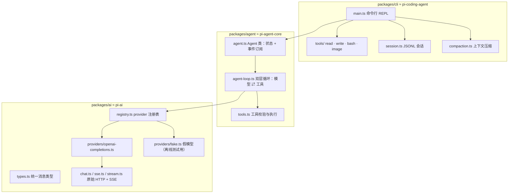

# mini-pi 🐱

一边写一边学：从零手写一个**最小的 AI agent 框架**（agent harness），照着 [earendil-works/pi](https://github.com/earendil-works/pi)（我 fork 在 [fragrans-maotou/pi](https://github.com/fragrans-maotou/pi)）的结构来。

大项目的代码太多，看不进去？那就不看了，**自己按步骤写一个小的**。每一步只多一点点，写完马上能跑、能测。写到最后，你会有一个能读文件、写文件、跑命令、记住对话、自动压缩上下文、还能画图的命令行 agent，而且每一行你都明白为什么这么写。

> 文档用中文，代码里的变量名、函数名用英文。

## 架构：三个包，和 pi 一一对应



| mini-pi | pi 里对应的 | 一句话 |
|---|---|---|
| `packages/ai` | [`packages/ai`](https://github.com/fragrans-maotou/pi/blob/main/packages/ai/src/types.ts)（pi-ai） | 不管哪家模型，都变成同一种消息格式 |
| `packages/agent` | [`packages/agent`](https://github.com/fragrans-maotou/pi/blob/main/packages/agent/src/agent-loop.ts)（pi-agent-core） | 模型想调工具就调，调完把结果喂回去，直到它说完 |
| `packages/cli` | [`packages/coding-agent`](https://github.com/fragrans-maotou/pi/blob/main/packages/coding-agent/src/core/agent-session.ts)（pi-coding-agent） | 把上面两个装进一个能用的命令行工具 |

## 快速开始

需要 Node.js **22+**（20 也基本能跑）。

```bash
git clone https://github.com/fragrans-maotou/mini-pi.git
cd mini-pi
npm install
cp .env.example .env     # 然后编辑 .env
npm run step1 -- "你好，介绍一下你自己"
npm run step2 -- "写一首关于猫的小诗"
```

### 配置（.env）

| 变量 | 说明 | 例子 |
|---|---|---|
| `OPENAI_BASE_URL` | 任何 OpenAI 兼容接口的地址（到 `/v1`） | `https://api.openai.com/v1`、`https://api.deepseek.com/v1`、本地 `http://192.168.x.x:端口/v1` |
| `OPENAI_API_KEY` | key；本地服务不校验的话随便填 `local` | `sk-...` |
| `MODEL` | 模型名 | `gpt-4o-mini`、`deepseek-chat` |
| `IMAGE_BASE_URL` / `IMAGE_API_KEY` / `IMAGE_MODEL` | 第 11 步生图用 | `http://192.168.31.175:7868/v1` |

`.env` 已经在 `.gitignore` 里，**不会被提交**。没配好时 step1/step2 会用中文告诉你缺什么。

### 常用命令

```bash
npm run step1          # 第 1 步：调一次模型（已实现）
npm run step2          # 第 2 步：流式输出（已实现）
npm test               # 已实现部分的离线测试（不需要 key）
npm run verify -- 06   # 跑第 6 步的验收测试（你写完 TODO 后它才会变绿）
npm run verify         # 跑所有步骤的验收测试
npm run typecheck      # 类型检查
npm run chat           # 最终的命令行 agent（第 8 步之后能用）
```

## 路线图

| # | 步骤 | 状态 |
|---|---|---|
| 01 | [调一次模型](docs/steps/01-call-model.md) | ✅ 已实现（参考） |
| 02 | [流式输出（SSE）](docs/steps/02-streaming.md) | ✅ 已实现（参考） |
| 03 | [统一消息类型](docs/steps/03-unified-types.md) | 📝 TODO |
| 04 | [provider 注册表](docs/steps/04-provider-registry.md) | 📝 TODO |
| 05 | [定义工具 + 模型调用工具](docs/steps/05-tools.md) | 📝 TODO |
| 06 | [Agent 循环（核心！）](docs/steps/06-agent-loop.md) | 📝 TODO |
| 07 | [事件与钩子](docs/steps/07-events-hooks.md) | 📝 TODO |
| 08 | [内置工具 read / write / bash](docs/steps/08-builtin-tools.md) | 📝 TODO |
| 09 | [会话保存 JSONL](docs/steps/09-session-jsonl.md) | 📝 TODO |
| 10 | [上下文压缩](docs/steps/10-compaction.md) | 📝 TODO |
| 11 | [加分：把生图做成工具](docs/steps/11-image-tool.md) | 📝 TODO |

详细说明见 [docs/roadmap.md](docs/roadmap.md)。

**关于答案**：这个仓库故意**不放**第 3 步以后的答案——要自己写才学得会 😼。每一步都有类型签名、TODO 注释和验收测试，测试变绿就说明写对了。卡住了可以去看文档里链接的 pi 源码。

## 致谢

本项目的结构和概念来自 [pi](https://github.com/earendil-works/pi)（作者 Mario Zechner 及贡献者，MIT 协议）。这里是为了学习而做的极简重写，没有大段复制 pi 的代码。

## License

MIT
